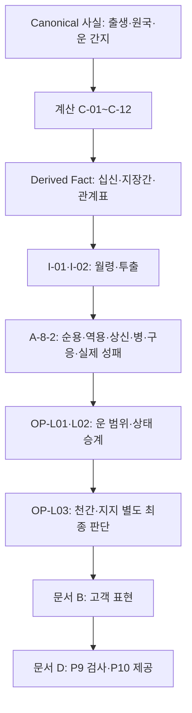

# 규칙 의존성·참조 지도

실행 선행과 문헌 상호참조를 구별한다. 단순 Rule ID 인용은 선행 계산의 증거가 아니다. Canonical Fact / Derived Fact / Final Judgment / Operator Review / Customer Rendering은 설명용 계층명이며 원문 Rule ID가 아니다.

## 원문에 명시된 처리 흐름

위 단계 순서는 D H-5-2 1~12, A-8-2의 10단계·A-8-6·A-8-7에 근거한다. 명리 최종 판단→Operator Review의 자동승인 분기는 원문에 없으므로 그래프에 추가하지 않았다. OP 승인 이력은 기준본 확정이고 각 실행마다 요구되는 승인이 아니다.

- OP-T10: OP-L01의 직접 비교 운끼리 합 → 상호 약화 → 원국 재합 제외 → 미합 운만 원국 상대 검토 → OP-T07.
- OP-L02: 상위 단계의 원국 변화 → 하위 단계 승계. 원국 변화가 아닌 운끼리 약화는 승계하지 않음.
- I-02 → I-02a: 투출 사실이 있은 뒤 합거되어도 분류 유지.
- I-04의 상신 힘 검토는 I-05 통근·I-06 위치를 함께 본다고 명시.

## A 정의행 직접 참조 목록 (dependency로 자동 실행하지 않음)

| 참조하는 Rule ID | 참조 대상 Rule ID | A 원문 |
| --- | --- | --- |
| C-03 | U-N5 | [A:55](/workspaces/filune/src/docs/source/A_rev179.md:55) |
| C-06 | U-N5 | [A:58](/workspaces/filune/src/docs/source/A_rev179.md:58) |
| C-10 | I-02 | [A:377](/workspaces/filune/src/docs/source/A_rev179.md:377) |
| C-11 | OP-L01 | [A:63](/workspaces/filune/src/docs/source/A_rev179.md:63) |
| I-01 | I-02 | [A:374](/workspaces/filune/src/docs/source/A_rev179.md:374) |
| I-02 | C-10 | [A:375](/workspaces/filune/src/docs/source/A_rev179.md:375) |
| I-04 | I-05 | [A:85](/workspaces/filune/src/docs/source/A_rev179.md:85) |
| I-04 | I-06 | [A:85](/workspaces/filune/src/docs/source/A_rev179.md:85) |
| I-04 | U-A3 | [A:85](/workspaces/filune/src/docs/source/A_rev179.md:85) |
| I-06 | U-N1 | [A:89](/workspaces/filune/src/docs/source/A_rev179.md:89) |
| I-07 | U-N4 | [A:90](/workspaces/filune/src/docs/source/A_rev179.md:90) |
| I-08 | OP-T06 | [A:91](/workspaces/filune/src/docs/source/A_rev179.md:91) |
| I-08 | OP-T08 | [A:91](/workspaces/filune/src/docs/source/A_rev179.md:91) |
| I-08 | OP-T09 | [A:91](/workspaces/filune/src/docs/source/A_rev179.md:91) |
| I-08 | OP-T10 | [A:91](/workspaces/filune/src/docs/source/A_rev179.md:91) |
| I-08 | OP-T12 | [A:91](/workspaces/filune/src/docs/source/A_rev179.md:91) |
| I-08a | OP-T04 | [A:92](/workspaces/filune/src/docs/source/A_rev179.md:92) |
| I-09 | OP-Z08 | [A:95](/workspaces/filune/src/docs/source/A_rev179.md:95) |
| I-09 | OP-Z10 | [A:95](/workspaces/filune/src/docs/source/A_rev179.md:95) |
| I-09 | OP-Z11 | [A:95](/workspaces/filune/src/docs/source/A_rev179.md:95) |
| I-09 | U-A1 | [A:95](/workspaces/filune/src/docs/source/A_rev179.md:95) |
| I-09 | U-A2 | [A:95](/workspaces/filune/src/docs/source/A_rev179.md:95) |
| I-10a | OP-Z03 | [A:97](/workspaces/filune/src/docs/source/A_rev179.md:97) |
| I-10a | OP-Z05 | [A:97](/workspaces/filune/src/docs/source/A_rev179.md:97) |
| I-10a | U-N3 | [A:97](/workspaces/filune/src/docs/source/A_rev179.md:97) |
| I-12 | OP-L01 | [A:103](/workspaces/filune/src/docs/source/A_rev179.md:103) |
| I-12 | OP-L02 | [A:103](/workspaces/filune/src/docs/source/A_rev179.md:103) |
| I-12 | U-A5 | [A:103](/workspaces/filune/src/docs/source/A_rev179.md:103) |
| I-14 | OP-L03 | [A:105](/workspaces/filune/src/docs/source/A_rev179.md:105) |
| I-20 | OP-R01 | [A:322](/workspaces/filune/src/docs/source/A_rev179.md:322) |
| I-21 | OP-R02 | [A:323](/workspaces/filune/src/docs/source/A_rev179.md:323) |
| I-21 | OP-T04 | [A:323](/workspaces/filune/src/docs/source/A_rev179.md:323) |
| I-22 | OP-R03 | [A:324](/workspaces/filune/src/docs/source/A_rev179.md:324) |
| IR-01 | OP-L02 | [A:425](/workspaces/filune/src/docs/source/A_rev179.md:425) |
| IR-01 | OP-P05 | [A:425](/workspaces/filune/src/docs/source/A_rev179.md:425) |
| IR-02 | C-10 | [A:426](/workspaces/filune/src/docs/source/A_rev179.md:426) |
| IR-02 | I-02 | [A:426](/workspaces/filune/src/docs/source/A_rev179.md:426) |
| IR-03 | OP-T03 | [A:427](/workspaces/filune/src/docs/source/A_rev179.md:427) |
| IR-03 | OP-T12 | [A:427](/workspaces/filune/src/docs/source/A_rev179.md:427) |
| IR-04 | I-14 | [A:428](/workspaces/filune/src/docs/source/A_rev179.md:428) |
| IR-04 | OP-L03 | [A:428](/workspaces/filune/src/docs/source/A_rev179.md:428) |
| IR-05 | I-04b | [A:429](/workspaces/filune/src/docs/source/A_rev179.md:429) |
| OP-L03 | I-14 | [A:413](/workspaces/filune/src/docs/source/A_rev179.md:413) |
| OP-P01 | OP-L01 | [A:416](/workspaces/filune/src/docs/source/A_rev179.md:416) |
| OP-P01 | U-A3 | [A:416](/workspaces/filune/src/docs/source/A_rev179.md:416) |
| OP-P02 | C-03 | [A:417](/workspaces/filune/src/docs/source/A_rev179.md:417) |
| OP-P02 | C-06 | [A:417](/workspaces/filune/src/docs/source/A_rev179.md:417) |
| OP-P02 | U-N5 | [A:417](/workspaces/filune/src/docs/source/A_rev179.md:417) |
| OP-P03 | U-A5 | [A:418](/workspaces/filune/src/docs/source/A_rev179.md:418) |
| OP-P03 | U-N6 | [A:418](/workspaces/filune/src/docs/source/A_rev179.md:418) |
| OP-P04 | U-N7 | [A:419](/workspaces/filune/src/docs/source/A_rev179.md:419) |
| OP-P04 | U-N8 | [A:419](/workspaces/filune/src/docs/source/A_rev179.md:419) |
| OP-R02 | OP-T04 | [A:323](/workspaces/filune/src/docs/source/A_rev179.md:323) |
| OP-T03 | OP-T04 | [A:235](/workspaces/filune/src/docs/source/A_rev179.md:235) |
| OP-T03 | OP-T07 | [A:235](/workspaces/filune/src/docs/source/A_rev179.md:235) |
| OP-T03 | OP-T08 | [A:235](/workspaces/filune/src/docs/source/A_rev179.md:235) |
| OP-T05 | OP-L01 | [A:237](/workspaces/filune/src/docs/source/A_rev179.md:237) |
| OP-T05 | OP-T10 | [A:237](/workspaces/filune/src/docs/source/A_rev179.md:237) |
| OP-T05 | OP-T11 | [A:237](/workspaces/filune/src/docs/source/A_rev179.md:237) |
| OP-T06 | I-08 | [A:238](/workspaces/filune/src/docs/source/A_rev179.md:238) |
| OP-T06 | OP-T08 | [A:238](/workspaces/filune/src/docs/source/A_rev179.md:238) |
| OP-T06 | U-N1 | [A:238](/workspaces/filune/src/docs/source/A_rev179.md:238) |
| OP-T07 | OP-T03 | [A:239](/workspaces/filune/src/docs/source/A_rev179.md:239) |
| OP-T07 | OP-T04 | [A:239](/workspaces/filune/src/docs/source/A_rev179.md:239) |
| OP-T07 | U-O1 | [A:239](/workspaces/filune/src/docs/source/A_rev179.md:239) |
| OP-T10 | OP-T07 | [A:395](/workspaces/filune/src/docs/source/A_rev179.md:395) |
| OP-T12 | OP-T02 | [A:393](/workspaces/filune/src/docs/source/A_rev179.md:393) |
| OP-Z06 | OP-Z09 | [A:251](/workspaces/filune/src/docs/source/A_rev179.md:251) |
| OP-Z06 | OP-Z10 | [A:251](/workspaces/filune/src/docs/source/A_rev179.md:251) |
| OP-Z08 | I-09 | [A:401](/workspaces/filune/src/docs/source/A_rev179.md:401) |
| OP-Z10 | OP-Z06 | [A:400](/workspaces/filune/src/docs/source/A_rev179.md:400) |
| OP-Z11 | I-09 | [A:401](/workspaces/filune/src/docs/source/A_rev179.md:401) |
| U-A1 | I-09 | [A:116](/workspaces/filune/src/docs/source/A_rev179.md:116) |
| U-A1 | OP-Z08 | [A:116](/workspaces/filune/src/docs/source/A_rev179.md:116) |
| U-A2 | I-09 | [A:117](/workspaces/filune/src/docs/source/A_rev179.md:117) |
| U-A3 | I-04 | [A:118](/workspaces/filune/src/docs/source/A_rev179.md:118) |
| U-A3 | I-06 | [A:118](/workspaces/filune/src/docs/source/A_rev179.md:118) |
| U-A3 | OP-P01 | [A:118](/workspaces/filune/src/docs/source/A_rev179.md:118) |
| U-A4 | C-10 | [A:119](/workspaces/filune/src/docs/source/A_rev179.md:119) |
| U-A4 | I-02 | [A:119](/workspaces/filune/src/docs/source/A_rev179.md:119) |
| U-A4 | I-11 | [A:119](/workspaces/filune/src/docs/source/A_rev179.md:119) |
| U-A5 | I-12 | [A:120](/workspaces/filune/src/docs/source/A_rev179.md:120) |
| U-A5 | OP-L01 | [A:120](/workspaces/filune/src/docs/source/A_rev179.md:120) |
| U-A5 | OP-P03 | [A:120](/workspaces/filune/src/docs/source/A_rev179.md:120) |
| U-N1 | I-08 | [A:121](/workspaces/filune/src/docs/source/A_rev179.md:121) |
| U-N1 | OP-T03 | [A:121](/workspaces/filune/src/docs/source/A_rev179.md:121) |
| U-N1 | OP-T06 | [A:121](/workspaces/filune/src/docs/source/A_rev179.md:121) |
| U-N1 | OP-T07 | [A:121](/workspaces/filune/src/docs/source/A_rev179.md:121) |
| U-N1 | OP-T08 | [A:121](/workspaces/filune/src/docs/source/A_rev179.md:121) |
| U-N2 | I-08 | [A:122](/workspaces/filune/src/docs/source/A_rev179.md:122) |
| U-N2 | I-12 | [A:122](/workspaces/filune/src/docs/source/A_rev179.md:122) |
| U-N2 | OP-T03 | [A:122](/workspaces/filune/src/docs/source/A_rev179.md:122) |
| U-N2 | OP-T07 | [A:122](/workspaces/filune/src/docs/source/A_rev179.md:122) |
| U-N3 | I-10a | [A:123](/workspaces/filune/src/docs/source/A_rev179.md:123) |
| U-N3 | OP-Z03 | [A:123](/workspaces/filune/src/docs/source/A_rev179.md:123) |
| U-N4 | I-07 | [A:124](/workspaces/filune/src/docs/source/A_rev179.md:124) |
| U-N5 | C-03 | [A:125](/workspaces/filune/src/docs/source/A_rev179.md:125) |
| U-N5 | C-06 | [A:125](/workspaces/filune/src/docs/source/A_rev179.md:125) |
| U-N5 | OP-P02 | [A:125](/workspaces/filune/src/docs/source/A_rev179.md:125) |
| U-N7 | C-02 | [A:127](/workspaces/filune/src/docs/source/A_rev179.md:127) |
| U-N7 | OP-P04 | [A:127](/workspaces/filune/src/docs/source/A_rev179.md:127) |
| U-N8 | C-12 | [A:128](/workspaces/filune/src/docs/source/A_rev179.md:128) |
| U-N8 | OP-P04 | [A:128](/workspaces/filune/src/docs/source/A_rev179.md:128) |
| U-O1 | OP-T07 | [A:274](/workspaces/filune/src/docs/source/A_rev179.md:274) |
| U-O2 | OP-T08 | [A:275](/workspaces/filune/src/docs/source/A_rev179.md:275) |
| U-O3 | OP-T02 | [A:276](/workspaces/filune/src/docs/source/A_rev179.md:276) |
| U-O3 | OP-T09 | [A:276](/workspaces/filune/src/docs/source/A_rev179.md:276) |
| U-O4 | OP-T07 | [A:395](/workspaces/filune/src/docs/source/A_rev179.md:395) |
| U-O7 | OP-T02 | [A:366](/workspaces/filune/src/docs/source/A_rev179.md:366) |
| U-O7 | OP-T07 | [A:366](/workspaces/filune/src/docs/source/A_rev179.md:366) |
| U-O7 | OP-T09 | [A:366](/workspaces/filune/src/docs/source/A_rev179.md:366) |
| U-O8 | OP-Z09 | [A:367](/workspaces/filune/src/docs/source/A_rev179.md:367) |

## cycle 확인

처리 단계 그래프는 순방향이며 cycle 없음. 개별 Rule ID의 문헌 참조 그래프에는 아래 상호참조 집합이 존재한다. 이를 그대로 평가 호출로 만들면 cycle 가능성이 있다.

- C-03, C-06, OP-P02, U-N5
- C-10, I-02
- I-04, OP-P01, U-A3
- I-07, U-N4
- I-08, OP-T06, U-N1
- I-09, OP-Z08, OP-Z11, U-A1, U-A2
- I-10a, U-N3
- I-12, OP-P03, U-A5
- I-14, OP-L03
- OP-P04, U-N7, U-N8
- OP-T03, OP-T07, U-O1
- OP-Z06, OP-Z10

## 검토 필요 연결

- canonical pointer→모든 판단 입력의 완전한 공급: 상태/역할/출처/유효기간 schema가 원문에 없으므로 아직 계약 미확정.
- 최종 판단→Operator Review→발행: 실행별 승인 분기 미정. 승인 규칙 이력에서 유추 금지.
- 근거의 질적 강약→유리 우세/불리 우세 단계: 수치·임계값 미정이며 새 점수 금지.
- 같은 운 글자를 포함한 상위/하위 재평가 순환: IR-01 및 OP-L02의 중복 금지·승계 규정으로 처리해야 하며 재귀 고정점 알고리즘을 추론하지 않음.
